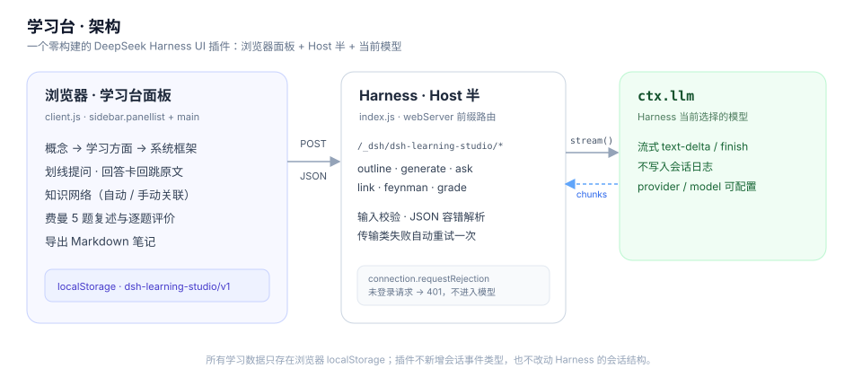

# 学习台 · dsh-learning-studio

[](https://github.com/lucas-sys/dsh-learning-studio/actions/workflows/test.yml)
[](LICENSE)


一个装在 [DeepSeek Harness](https://github.com/deepseek-ai) 里的学习工作区插件。

它解决的是「读一篇长讲解时，问题越问越多，聊天窗口越拉越长」的问题：正文单独成页，疑问挂在右侧，回答锚回原文，问题之间连成网络；学完再用费曼法自检，最后把整个过程整理成一份 Markdown 笔记。



## 它做什么

1. **概念 → 学习框架**
   只输入一个概念名称。AI 先按结构化知识模板列出 6-9 个可学的方面（定义、意义、机制、构成、例子、边界、相邻概念……），每一项都带「这个方面要回答什么」。勾选你真正想学的，再生成一份按这些方面逐节展开的系统讲解。也保留「直接粘贴现成材料」的入口。

2. **划线提问，回答回到原文**
   在正文里划出一句话，就在右侧提问。回答卡片始终保留划线片段，点高亮或点段落都能跳回原文并定位到对应卡片。侧栏的疑问按**文章位置**排序，而不是按提问时间，复习时可以顺着文章往下读。

3. **回答成网**
   提问之间自动判断知识关联（因果 / 前提 / 对比 / 同一机制 / 延伸），也可以手动关联。「知识网络」页按原文小节分列画出结构图。

4. **费曼检验**
   学完后让模型基于导读出 5 个关键问题，你用自己的话复述；模型逐题评价（通过 / 还需补充 / 需要重来），指出遗漏并给一句提示。

5. **导出笔记**
   所有复述题通过后解锁 Markdown 笔记，包含导读、每条问答与关联、每道复述题的原文与评价，以及本次覆盖的学习方面。

## 安装

### 前提

- 一个支持插件 bundle 的 DeepSeek Harness（桌面端或 Web 端）。
- 安装插件需要在 Harness 中具备 Full access（安装动作会执行 Host 代码）。
- Node.js 只在跑测试时需要，日常使用不需要。

### 步骤

```bash
git clone https://github.com/lucas-sys/dsh-learning-studio.git ~/dsh-learning-studio
```

然后在 Harness 里让 agent 安装这个目录：

```
plugin_manager({ action: "install_bundle", target: "/Users/<you>/dsh-learning-studio" })
```

安装器会把它链接进当前 profile；之后重启一次 Harness，并在 Web UI 按 `Cmd+Shift+R` 刷新，左侧栏会出现「学习台」图标。

> 不要手动修改 profile 的 `package.json` 或 `cordis.patch.yml`，安装与卸载都走 `plugin_manager`。

### 更新

```bash
cd ~/dsh-learning-studio && git pull
```

只改了 Client 半时刷新页面即可；Host 半有变化时重启 Harness。

### 卸载

```
plugin_manager({ action: "remove_bundle", target: "dsh-learning-studio" })
```

浏览器里的学习数据不会被卸载清除，需要时在站点设置里清空 `localStorage`。

## 使用流程

1. 点侧栏「学习台」→「新建学习」，输入概念与深度（入门 / 系统 / 深入），点「下一步：选择范围」。
2. 在 AI 给出的方面清单里勾选、补充或重新生成，点「生成系统框架」。
3. 阅读时划词提问；回答出现在右栏。点高亮跳到具体问题，点段落跳到该段最早的一条，卡片会滚动并闪烁。
4. 回答完成后会自动关联；也可以在卡片上手动「关联」。切到「知识网络」查看结构。
5. 学得差不多了，切到「费曼检验」→「生成关键问题」，逐题复述，直到全部通过。
6. 到「笔记」页复制或下载 `.md`。

## 数据与隐私

- 所有导读、问答、关联、费曼记录都存在浏览器 `localStorage`，键为 `dsh-learning-studio/v1`。
- 模型调用由插件 Host 半通过 Harness 的 `ctx.llm` 发起，**不写入会话日志**，也不新增会话事件类型。
- Host 路由挂在 `/_dsh/dsh-learning-studio/*`，进入处理前先执行 `connection.requestRejection`，未登录请求直接 401。
- 插件不收集遥测，不访问第三方服务。

## 接口

| 方法 | 用途 |
| --- | --- |
| `ping` | 健康检查，返回版本与模型是否就绪 |
| `outline` | 概念 → 学习方面清单（title / summary / keyQuestions） |
| `generate` | 按选定 `aspects` 生成系统讲解（Markdown） |
| `ask` | 针对划线片段与所在段落提问 |
| `link` | 在新回答与已有卡片之间判断关联 |
| `feynman` | 基于导读生成 5 个关键问题 |
| `grade` | 评价一次费曼复述，给出遗漏与提示 |

请求为同源 `POST`，JSON 进 JSON 出。模型默认取 Harness 当前选择；也可以在 Loader 配置里写 `provider` / `model` / `reasoningEffort` 覆盖。

## 已知边界

- 只支持段内划词：跨段落选择不会建立锚点，因为回答需要精确指回原文位置。
- 关联与评价都由模型判断；评价 JSON 解析失败时会降级为「还需补充」，并保留模型原始反馈。
- 笔记导出默认要求费曼题目全部通过；评价接口异常时可用「仍要导出」自救。
- 数据只在本地：换浏览器或清空站点数据会丢失，重要笔记请及时下载。
- 模型连接偶发中断（例如 `DeepSeek message transport fail`）时，Host 会对传输类错误自动重试一次；仍失败则卡片显示错误与「重试」按钮，问题本身不会丢。费曼评价失败同样保留复述原文，可直接重试。
- 学习台是阅读工作区，不替代 Harness 的会话；同一概念的多轮追问请留在学习台里，避免把聊天窗口撑长。

## 开发

零构建、零运行时依赖。`index.js` 是 Host 半，`client.js` 是 `window.__ModuleLoader__` 直接加载的 Client 半。

```bash
node --check index.js
node --check client.js
node test/smoke.mjs   # 注册、冷启动、渲染、交互属性
node test/host.mjs    # 路由、校验、解析、重试
```

更详细的约定见 [CONTRIBUTING.md](CONTRIBUTING.md)，版本变化见 [CHANGELOG.md](CHANGELOG.md)。

## License

[MIT](LICENSE)

---

### English

**dsh-learning-studio** is a DeepSeek Harness UI plugin for deep reading. Give it a concept: it first proposes a structured set of learning aspects, then writes a systematic guide from the ones you pick. Highlight any sentence to ask a question; answers live in the side panel, stay anchored to the text, and link to each other as a knowledge graph. When you are done, a Feynman-style quiz asks you to restate the key ideas in your own words and grades each attempt, and the whole session can be exported as a Markdown note.

Install with `plugin_manager({ action: "install_bundle", target: "<repo path>" })`, then restart Harness and refresh the Web UI. Data stays in `localStorage`; model calls go through `ctx.llm` and are not written to the session log. MIT licensed.
